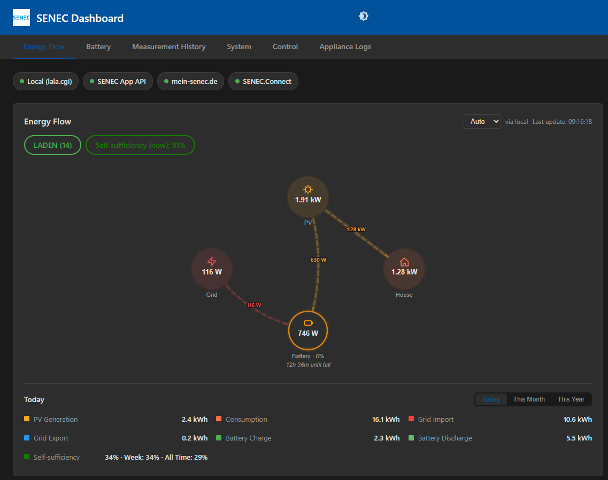
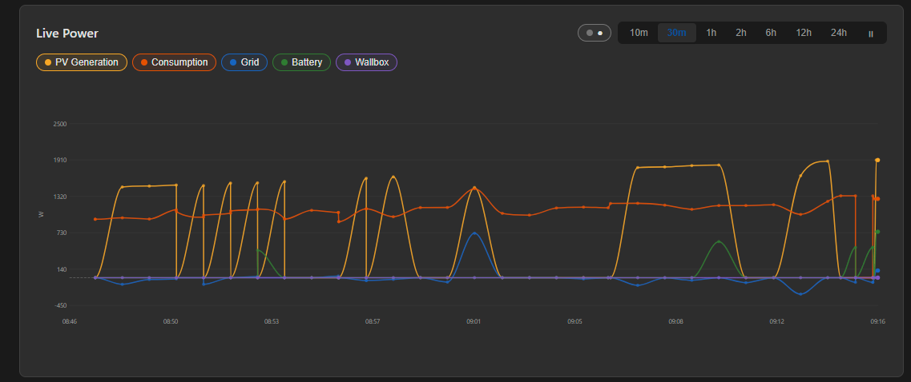
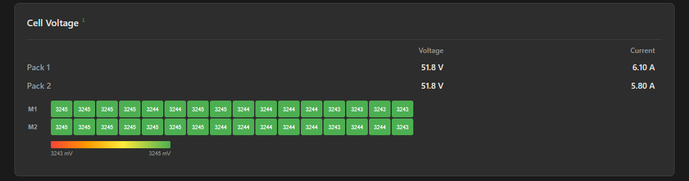
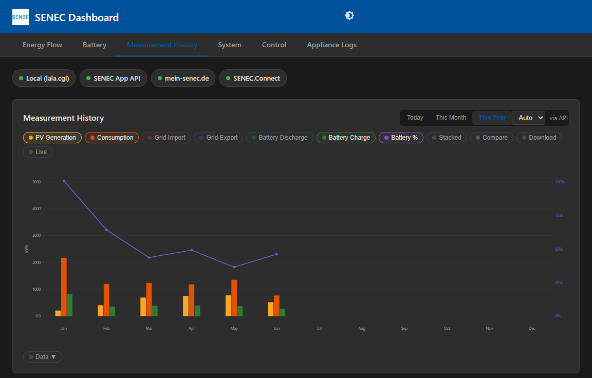

#  ioBroker.senec

**Tests:** 

## SENEC adapter for ioBroker

[Dokumentation DE](docs/de/README.md) | [Documentation EN](docs/en/README.md)

> [!IMPORTANT]
> ### 🔎 Wanted: testers for the SENEC.Connect connector
>
> SENEC.Connect is the newest of the four connectors, and it is the one I have the least real-world data for — I cannot see what your subscription returns. **If SENEC.Connect reports anything at all for your account, please get in touch:** in the [ioBroker forum thread](https://forum.iobroker.net/topic/30620/neuer-adapter-senec-home-adapter) or via a [GitHub issue](https://github.com/nobl/ioBroker.senec/issues).
>
> Especially valuable:
> - **accounts holding more than one system** — a replaced appliance, or two systems at one address;
> - responses containing **more than `battery` and `meter`**, for instance `evse` (wallbox) or `bessNameplate`;
> - anything the adapter logs as `REPORT_TO_DEV`.
>
> The most useful thing you can send is the raw response: switch on *Log requests and responses* under the SENEC.Connect debug settings, set the log level to debug, and copy what the adapter writes out. **Please replace serial numbers and system ids with `***` before posting** — the rest is what matters.

Your SENEC system knows a great deal about itself. This adapter brings all of it into ioBroker — down to individual cell voltages and per-phase grid quality — and comes with a dashboard you do not have to build.

That screenshot is not a vis project someone assembled. It ships with the adapter, needs no extra adapters or widgets, and is running as soon as the instance is. Dark and light theme, 11 languages, usable on a phone.

### Four Ways In

The appliance answers on your own network, and SENEC runs three cloud services. The adapter speaks all four, independently.

**The local connector needs nothing but an IP address.** No account, no credentials, no request ever leaving your network — that is where this adapter started and it still works that way on its own. The cloud connectors are there when you want the measurement history and portal features that only exist online, or when your appliance has no local interface to talk to.

| Connector | Data source | Update speed | Key capabilities |
|-----------|------------|-------------|-----------------|
| **[Local](docs/en/README.md#local-connection-lalacgi)** | lala.cgi (LAN) | 10s real-time | Full BMS data, grid meter, wallbox, appliance control |
| **[SENEC App API](docs/en/README.md#senec-app-api)** | Cloud API | 6 min | Dashboard, measurements, system details |
| **[mein-senec.de](docs/en/README.md#mein-senecde)** | Web portal | 6 min | Measurements, emergency power, peak shaving, SG-Ready, sockets |
| **[SENEC.Connect](docs/en/README.md#senecconnect)** | Azure API | 5 min | Battery & meter data |

Replaced your appliance? Both systems stay on your mein-senec.de account, and the adapter finds [all of them](docs/en/README.md#additional-systems-on-the-account) — so the old one's history stays reachable next to the new one's live data.

One is enough to get started. Combining them is where it gets interesting: the local connection gives ten-second resolution and the deepest detail, while the cloud services hold years of measurement history and features that exist nowhere else — emergency power reserve, peak shaving, SG-Ready, switchable sockets. And if one source is down, or your appliance has no local interface at all, the others carry on regardless.

### Built-in Dashboard

**[Overview](docs/en/README.md#overview-tab)** — Live energy flow diagram with animated power paths, battery SOC gauge, operating mode, period totals with autarky. Event timeline showing today's warnings and errors.

**[Live power curve](docs/en/README.md#overview-tab)** — Drag through history and pinch to zoom, from a five-minute window out to thirty days, on a desktop or a tablet. If you log the power states with InfluxDB, SQL or History, the chart backfills from them and you can pan back through everything you have recorded.

**[Battery](docs/en/README.md#battery-tab)** — State of health per pack, charge cycles, cell voltage heatmap (spot imbalance at a glance), temperatures.

**[Charts](docs/en/README.md#charts-tab)** — Measurement history (hourly/daily/monthly/yearly) with comparison mode, stacked view, battery level overlay, data table, PNG export.

**[System](docs/en/README.md#system-tab)** — Grid quality (frequency, per-phase voltage/power/current), PV string details, wallbox info, feature flags, firmware versions.

**[Control](docs/en/README.md#control-tab)** — Force charge, appliance reboot, emergency power reserve, peak shaving, SG-Ready, switchable sockets, wallbox control. Available via Local and/or mein-senec.de.

**[Logs](docs/en/README.md#logs-tab)** — Browse device logs by date, filter by level/category, live mode, download.

**[Statistics](docs/en/README.md#statistics-tab)** — Browse the weekly 5-minute exports mein-senec.de keeps, going back years. Filter by day, switch between hourly and 5-minute resolution, chart or table, and export what you select.

### [External Energy Sources](docs/en/README.md#external-sources)

Integrate third-party PV inverters, consumers (wallbox, heat pump, etc.), and batteries from other ioBroker adapters into the SENEC dashboard. Values can be mapped directly from states or calculated via formulas (e.g. `{voltage.state} * {current.state}`). External sources appear in the energy flow diagram and live power chart — either added to SENEC totals or shown as separate nodes.

### Built to Keep Running

An adapter polling a battery every ten seconds runs unattended for years, so most of the work is in the parts you never see.

**It validates the connection to your appliance.** Local polling is HTTPS, and the certificate chain is verified against the CA you upload or one the adapter fetches from the portal for you. Where no CA can be obtained, the adapter falls back to recording the appliance's certificate fingerprint on first contact and warning you whenever it changes — continuity monitoring rather than full verification, chosen so a legitimate certificate change never leaves you disconnected. [How it works](docs/en/README.md#tls-certificate-validation)

**It backs off instead of hammering.** Cloud requests run through a queue that watches success rates, widens the gap between requests when the server rate-limits or times out, and narrows it again once things recover.

**It recovers on its own.** A failed poll does not end polling. Connectors retry with growing delays and pick up where they left off, and `info.connectionStatus` tells you at a glance which sources are currently live.

**It can rebuild what it missed.** The App API connector can reconstruct lifetime measurement history from scratch, working backwards year by year in the background. [History rebuild](docs/en/README.md#history-rebuild)

### Supported Systems

Practically every SENEC storage system works: the Home range from the early lead-acid and lithium
models through V2, V2.1 and V3, the current V4 | P4 | E4 generation, the Business models, and the
partner variants ADS Tec, OEM LG and Solarinvert.

Systems with a local web interface can use all four connectors. Those without one — the V4
generation among them — work through the SENEC App API, mein-senec.de and SENEC.Connect. Which
data points appear varies by model.

See the [full list of models](docs/SUPPORTED_SYSTEMS.md) to find your system by name.

### Requirements

- ioBroker running on Node.js 22 or newer
- For the local connector: the SENEC appliance reachable on your network, and its IP address
- For the cloud connectors: a mein-senec.de account
- For the dashboard: the ioBroker.web adapter (most installations already have it)

### Quick Start

Configure **at least one** connector on a new instance — you do not need all four, and you can add the others later.

**Local, for real-time data.** Open the *[Local Connection](docs/en/README.md#local-connection-lalacgi)* tab and enter the appliance's IP address. That is the whole setup. This connector polls every 10 seconds and provides the most detail: full battery management data, per-phase grid values, wallbox information and appliance control.

**Cloud, if the appliance has no local web interface** (the V4 generation, for example) **or you would rather not poll it directly.** Enter your mein-senec.de credentials in the *[SENEC Account](docs/en/README.md#senec-account)* tab, then enable the *[SENEC App API](docs/en/README.md#senec-app-api)* or *[mein-senec.de](docs/en/README.md#mein-senecde)* connector. Both use the same credentials, and both support accounts with [two-factor authentication](docs/en/README.md#two-factor-authentication-2fa). Data arrives every few minutes rather than in real time.

Once an instance is running, the dashboard is at `http://<your-iobroker>:8082/senec/`. Running more than one system? Create an instance per system — each dashboard follows its own instance. States appear under `senec.0` — the [state reference](docs/en/README.md#state-reference) lists them all — and can be logged with any history adapter.

Beyond that: [every setting explained](docs/en/README.md#configuration), the [complete state reference](docs/en/README.md#state-reference), [control features](docs/en/README.md#appliance-control) and [troubleshooting](docs/en/README.md#troubleshooting).

### Reporting a Problem

For questions, setups and comparing notes with other users, there is a [dedicated thread in the ioBroker forum](https://forum.iobroker.net/topic/30620/neuer-adapter-senec-home-adapter) — mainly German, and usually the quickest way to an answer. For something that looks like a bug, please open an issue on [GitHub](https://github.com/nobl/ioBroker.senec/issues). It helps to include your system model, which connectors you have enabled, the adapter and ioBroker versions, and a debug-level log covering the failure — the documentation walks through [collecting one](docs/en/README.md#collecting-a-debug-log) and [what makes a report actionable](docs/en/README.md#reporting-an-issue).

One thing worth checking first: implausible readings usually originate in the appliance rather than in the adapter, which mostly passes values through. A value that looks wrong on the dashboard will generally look just as wrong in the appliance's own web interface — and if it does not, that difference is exactly what to put in the report.

## Disclaimer
**All product and company names or logos are trademarks™ or registered® trademarks of their respective holders. Use of them does not imply any affiliation with or endorsement by them or any associated subsidiaries! This personal project is maintained in spare time and has no business goal.**

**Control features are used at your own risk.** Force charge, appliance reboot, emergency power reserve, peak shaving, SG-Ready, socket switching and wallbox control each have to be enabled deliberately and acknowledged in the settings before they appear. The adapter sends what it is asked to send; it does not arbitrate between conflicting commands arriving from different connectors, nor does it judge whether a command is sensible for your system.

**Polling too aggressively can overload the appliance.** Shortening the local polling interval or adding extra high-priority data points can make the device restart, stop responding, or fail to synchronise with the SENEC cloud. If that happens, reduce the frequency or stop the adapter. The defaults are chosen to be safe.

**No warranty, and no liability.** This adapter is a spare-time project, provided as-is under the MIT license. It talks to an expensive appliance over interfaces SENEC neither documents nor supports, and it can send commands that change how that appliance behaves. Everything you do with it is your own responsibility. The author accepts no liability for damage to your system, lost or wrong data, missed feed-in, or any other consequence of using it — and cannot tell you whether using it affects your warranty or support arrangements with SENEC or your installer. If that is not acceptable to you, please do not use this adapter.

### Deprecated / Removed states
* STATISTIC
* Display
* _calc (not relevant anymore since we lost STATISTIC)
* BAT1OBJ[2-4] 

## Donate
Maintenance of this adapter can be quite time consuming. If you wish to thank the author, please use these links:

## Supporters
I am grateful to everyone who supports my work through GitHub Sponsors and in other ways. See [SUPPORTERS.md](SUPPORTERS.md) for acknowledgements.

## Changelog

<!--
  Placeholder for the next version (at the beginning of the line):
  ### **WORK IN PROGRESS**
-->
### **WORK IN PROGRESS**
- Fixed: **The App API's month-by-month history was a month out.** Every month's energy sat in the slot before it — so the year chart showed September's bars for October, and January was inflated because it had swallowed February as well. A month's readings run from local midnight to local midnight, but the adapter sorted them into months by UTC, which in Central Europe puts the first hour of each month into the one before it. The same mistake in the request window let an hour of New Year's Day land in the previous December. The month-by-month history is re-read once after the update so that what is already stored is corrected; yearly totals were never affected.
- New: **The energy totals can look back.** *Dieser Monat* and *Dieses Jahr* carry arrows now that step to the month or year beside the one shown, and the card's heading names the period it is actually showing. How far back the arrows reach is whatever the adapter has stored: the App API covers every year its all-time rebuild has filled in, the portal keeps a total for every year the system has run but a month-by-month breakdown for this year and last only. An installation polling the appliance alone has no history to step through and gets no arrows. SENEC reports *Autarkie* for the running period only, so for any period stepped to it is worked out from that period's own energy totals and may differ a little from the figure the portal shows.
- Fixed: The App API's monthly and yearly totals never appeared. The dashboard asked for them under the field names the dashboard endpoint uses, but the measurement history stores the cloud's own names and counts in kWh rather than Wh — so an installation running only the App API saw *no data* on both tabs.
- Fixed: Long values in the web dashboard's *System* card no longer paint over the cell beside them — a serial number or an installer e-mail address wraps inside its own column instead. The serial number is also shown last, on a line of its own, since it is the longest value in the card.
- dependency updates

### 2.16.4 (2026-10-28)
- New: **Chart colors can be changed.** The *Live Power* chart and the *Measurement History* tab each carry a **Colors** button that opens a picker per series, plus a **Default colors** button that puts them all back. A type keeps one color across both charts, so setting PV once is enough; a comparison series has nothing to pick, because it is drawn in its own type's color. The palette is stored in the adapter, not in the browser, so a phone and a wall tablet looking at the same system agree on it — and a color changed on one page appears on any other page that is open.
- Change: Battery charge level is drawn in one color now rather than two — the live chart's state-of-charge line takes the purple the measurement history already used, and the live chart's wallbox line moves to the shade the energy flow's wallbox total uses, so the two are still told apart. Both are pickable.

### 2.16.3 (2026-10-27)
- dependency updates

### 2.16.2 (2026-10-26)
- fixed bogus readme

### 2.16.1 (2026-10-26)
- New: The web dashboard now reads the **local OpenAPI**. Until now its values were polled but nothing on the dashboard looked at them, so an installation running only that connector saw an energy flow with no data in it. The energy flow, the live power chart and its history backfill now take it as a source of their own — selectable beside the diagram, and chosen automatically when `lala.cgi` polling is off. `lala.cgi` still wins where both run, because it polls six times as often.
- New: A *Battery (now)* card — state of charge, charge or discharge power, voltage, current and capacity — filled from whichever connectors you have enabled. An installation running only the local OpenAPI previously showed no battery readings at all.
- New: A *Local OpenAPI* card on the system tab, showing where the registration stands (including *not registered*, with what to do about it), whether the appliance is reachable, how long ago it last answered, and the certificate fingerprint. Reachability is reported separately from registration, because an approved registration whose appliance is switched off is still approved.
- New: The system tab fills in from the OpenAPI nameplate where it has nothing else — model, serial number, manufacturer, rated charge and discharge power, the AC-side readings, and each wallbox slot. Values read this way carry an **O** badge, alongside the existing L, A and W.
- New: `_openapi.info.lastCompletePoll` records the last cycle in which *every* requested section answered. `_openapi.info.lastPoll` is stamped as soon as one does, which is what the connection state needs, but anything reading several sections as one measurement needs to know they came from the same cycle.
- Fix: **The dashboard no longer shows values from a connector you have switched off.** Nothing deletes a connector's states when you disable it, so every card went on rendering whatever it last wrote — on one development system that meant an energy flow, an operating-mode badge and an entire battery tab built from readings two months old, presented as current. This applies everywhere, including the *Measurement History* tab, which could even pick a disabled connector as its source. A row that can come from several connectors keeps whichever is still in use, and a connector that is enabled but currently failing keeps its place, so nothing disappears while a connection is merely flapping.
- Fix: **The dashboard now recovers from a dropped connection.** It never did: the recovery ran only on the very first connect, so after any blip the page stopped noticing deleted states — a wallbox slot that had gone stayed on display — stopped hearing about configuration changes, and left a permanent hole in the live chart.
- Fix: Several ways the live power chart could stop backfilling and never start again: a history request lost to a dropped connection, a connection lost while it was working out which states are recorded, or panning while disconnected, which marked that stretch as loaded without ever asking for it. Collapsing or pausing the chart also left a permanent hole for the interval it skipped; it is now filled in when you resume.
- Fix: Switching the chart's data source while history was loading could mix the two sources together and issue several overlapping sets of queries at once.
- Fix: The live chart no longer empties and reloads its entire history every time the `lala.cgi` connector drops a single poll.
- Fix: Tabs that your enabled connectors cannot fill are hidden rather than shown empty, and the *Control* tab is no longer hidden when `lala.cgi` polling is off — a command is dispatched to whichever connector can carry it.
- Fix: The energy flow no longer presents zeros as a measurement when the connector it chose has published no power reading, and today's totals are cleared when no connector supplies them rather than staying on the last figures a cloud connector reported.
- Fix: A value the appliance reports as unavailable, or as a number too large to represent, is no longer published as `NaN` or `Infinity` on a state declared numeric — which silently breaks recording in InfluxDB — and no longer makes an export read as an import.
- Fix: A last-update time older than 36 hours now carries its date, instead of showing a time of day that reads as current at a glance.
- Fix: An external energy source's configured name is escaped where it is drawn into the energy-flow diagram.
- Fix: A few states could still be written while the adapter was shutting down.
- Dependency updates

### 2.16.0 (2026-10-25)
- New: A connector for the appliance's **local OpenAPI on port 4424** — a second local interface, independent of `lala.cgi` and read-only. It is **off by default** and available on **V2 and V3 systems only**; V4, P4 and E4 do not open the port. It shares the *Local Connection* tab and the appliance address with the `lala.cgi` connector, and either one works without the other. It needs a one-time registration that is approved in the SENEC portal, on a page reachable only by link. **With your SENEC account credentials filled in, the adapter handles that itself** — registering, approving and starting to poll, without the mein-senec.de connector having to be enabled; otherwise it writes the exact approval link to the log for you to open. `_openapi.info.approvalState` shows where the registration stands — not registered, waiting, approved, or no longer accepted — with buttons beside it to re-check the approval, or to de-register and discard the token. It serves battery, meter, nameplate and wallbox readings under `_openapi.*`. There is nothing writable: the two routes that would set a charge or discharge power refuse every request an end customer can make, approved or not. What the interface offers and refuses is documented in [docs/LOCAL_OPENAPI_4424.md](docs/LOCAL_OPENAPI_4424.md).
- New: The appliance address moved to the top of the *Local Connection* tab and is shown whenever either local connector is enabled. It was previously hidden unless `lala.cgi` polling was switched on, which left anyone who wanted only the new connector unable to enter it at all.
- New: The battery state read through SENEC.Connect now has a companion state spelling the code out in words, at `_connect.Systems.<system_id>.battery.state_Text`. Only `lala.cgi` states carried these before.
- Change: `BAT1.SPARE_CAPACITY` is now named *Emergency Power Reserve* and carries `%` as its unit. It is the local mirror of the emergency power reserve set on mein-senec.de, so the value you set in the portal is what appears here. It was previously listed under its raw name with no unit, which told nobody what the number meant.
- Change: SENEC.Connect honours a `Retry-After` the API sends with a 429 or 503 instead of coming back at the configured interval regardless. The endpoint is rate-limited per subscription, and ignoring the wait it asks for invites a longer block.
- Change: The house consumption from SENEC.Connect is now named for what its schema says it is — the figure excludes the wallbox load, which matters to anyone comparing it against the appliance's own.
- Fix: The documentation listed a writable state `control.BlockDischarge` for blocking battery discharge. No such state exists and none ever has, so the row is removed. The force-charge switch in the same table was misnamed too: it is `control.ForceLoadBattery`, not `control.ForceCharge`, and it is created on every instance alongside `control.RebootAppliance`. Whether the appliance offers a discharge block at all is tracked as a question of its own (#543).
- Fix: The documentation named `_local.FACTORY` and `_local.SYS_UPDATE` as the states holding model and firmware version for a bug report. Those are `FACTORY.*` and `SYS_UPDATE.*` at the root of the instance — `_local.` holds the TLS states and nothing else.
- Dependency updates

### [Former Updates](CHANGELOG_OLD.md)

## License
MIT License

Copyright (c) 2020-2026 Norbert Bluemle <github@bluemle.org>

Permission is hereby granted, free of charge, to any person obtaining a copy
of this software and associated documentation files (the "Software"), to deal
in the Software without restriction, including without limitation the rights
to use, copy, modify, merge, publish, distribute, sublicense, and/or sell
copies of the Software, and to permit persons to whom the Software is
furnished to do so, subject to the following conditions:

The above copyright notice and this permission notice shall be included in all
copies or substantial portions of the Software.

THE SOFTWARE IS PROVIDED "AS IS", WITHOUT WARRANTY OF ANY KIND, EXPRESS OR
IMPLIED, INCLUDING BUT NOT LIMITED TO THE WARRANTIES OF MERCHANTABILITY,
FITNESS FOR A PARTICULAR PURPOSE AND NONINFRINGEMENT. IN NO EVENT SHALL THE
AUTHORS OR COPYRIGHT HOLDERS BE LIABLE FOR ANY CLAIM, DAMAGES OR OTHER
LIABILITY, WHETHER IN AN ACTION OF CONTRACT, TORT OR OTHERWISE, ARISING FROM,
OUT OF OR IN CONNECTION WITH THE SOFTWARE OR THE USE OR OTHER DEALINGS IN THE
SOFTWARE.
